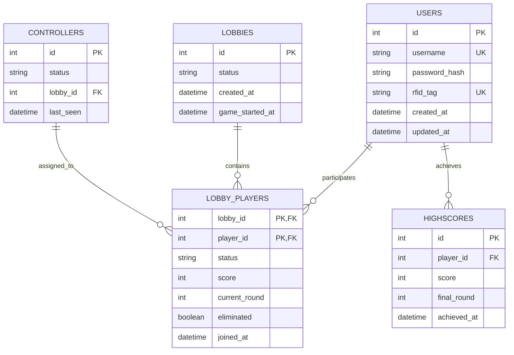

# Simon Goes Multiplayer - Projekt Dokumentation

## Projektteam
- **Jordan Freddy Pokem Tezo**
- **Kemvou Leslie Temfack Joyce**

## Sommersemester 2025 - Informatik Projekt

---

## Inhaltsverzeichnis
1. [Projektübersicht](#projektübersicht)
2. [Inbetriebnahme der Anwendung](#inbetriebnahme-der-anwendung)
3. [ERM-Diagramm](#erm-diagramm)
4. [RESTful API Beschreibung](#restful-api-beschreibung)
5. [Erfüllte User Stories](#erfüllte-user-stories)
6. [Nicht erfüllte User Stories](#nicht-erfüllte-user-stories)
7. [Optionale User Stories](#optionale-user-stories)
8. [Technische Architektur](#technische-architektur)

---

## Projektübersicht

"Simon Goes Multiplayer" ist eine erweiterte Version des klassischen Simon-Spiels, die es mehreren Spielern ermöglicht, gleichzeitig zu spielen. Das Projekt kombiniert Hardware-Controller, Web-Frontend und Backend-Logik zu einem vollständigen Multiplayer-Erlebnis.

### Hauptfunktionen
- **Multiplayer-Gameplay**: Mehrere Spieler können gleichzeitig spielen
- **Hardware-Controller**: Physische Controller mit LEDs und Buttons
- **Web-Controller**: Browser-basierte Controller für Spieler ohne Hardware
- **Echtzeit-Kommunikation**: MQTT-basierte Synchronisation
- **Highscore-System**: Globale Bestenliste mit Top 10 Scores
- **Benutzerverwaltung**: Registrierung und Login-System

---

## Inbetriebnahme der Anwendung

### Schnellstart mit Docker (Empfohlen)

```bash
# Repository klonen
git clone <repository-url>
cd group-05-test1

# Docker Container starten
docker-compose up -d

# Anwendung aufrufen
# Frontend: http://localhost
# Backend API: http://localhost:80
```

### Voraussetzungen
- Docker und Docker Compose
- Node.js (für lokale Entwicklung)
- Java 11+ (für Backend-Entwicklung)

### Manuelle Installation

#### Option 1: Docker (Recommandé)
```bash
# Cloner le repository
git clone <repository-url>
cd group-05-test1

# Démarrer avec Docker Compose
docker-compose up -d

# Vérifier que tous les services sont démarrés
docker-compose ps
```

#### Option 2: Installation locale (Développement uniquement)

**Prérequis :**
- Java 11+
- Node.js 16+
- MariaDB/MySQL
- MQTT Broker (ws://iti-mqtt.mni.thm.de:9001)

**Backend (Java) :**
```bash
cd java-backend

# Installer les dépendances Maven
mvn clean install

# Démarrer le backend
mvn spring-boot:run
```

**Frontend :**
```bash
cd frontend

# Installer les dépendances Node.js
npm install

# Démarrer le serveur de développement
npm start
```

**Base de données :**
```sql
-- Créer la base de données
CREATE DATABASE simon_game;

-- Exécuter le script de création des tables
-- (voir doc/ERM-Diagramm.md pour les scripts SQL complets)
```

### Configuration
Die Anwendung verwendet folgende Standard-Konfiguration:
- **Port**: 80 (Frontend), 8080 (Backend)
- **MQTT**: ws://iti-mqtt.mni.thm.de:9001
- **Datenbank**: MariaDB (in Docker)

### Fehlerbehebung

#### Häufige Probleme

**1. Port bereits belegt**
```bash
# Ports überprüfen
netstat -tulpn | grep :80
netstat -tulpn | grep :8080

# Container neu starten
docker-compose down
docker-compose up -d
```

**2. Datenbank-Verbindung fehlgeschlagen**
```bash
# Container-Status überprüfen
docker-compose ps

# Logs anzeigen
docker-compose logs java-backend
docker-compose logs mariadb
```

**3. MQTT-Verbindung fehlgeschlagen**
- Überprüfen Sie die Internetverbindung
- Der MQTT-Broker ist extern gehostet
- Firewall-Einstellungen überprüfen

**4. Frontend lädt nicht**
```bash
# Frontend-Logs überprüfen
docker-compose logs nginx

# Browser-Cache leeren
# Hard Refresh: Ctrl+F5
```

#### Nützliche Docker-Befehle

```bash
# Alle Container anzeigen
docker-compose ps

# Logs in Echtzeit verfolgen
docker-compose logs -f

# Container neu starten
docker-compose restart

# Alles stoppen und löschen
docker-compose down -v
```

---

## ERM-Diagramm

> **📋 Documentation complète :** [doc/ERM-Diagramm.md](doc/ERM-Diagramm.md)

### Datenbankstruktur



### Beschreibung der Entitäten

- **USERS**: Speichert Benutzerkonten mit RFID-Tags
- **CONTROLLERS**: Verwaltet Hardware- und Web-Controller
- **LOBBIES**: Spielsitzungen mit Status-Tracking
- **LOBBY_PLAYERS**: Verknüpfung zwischen Spielern und Lobbies
- **HIGHSCORES**: Globale Bestenliste der Spieler

---

## RESTful API Beschreibung

### Basis-URL
```
http://localhost:80/api
```

### Authentifizierung
Die API verwendet Session-basierte Authentifizierung.

### Endpunkte

#### Benutzerverwaltung

**POST /api/register**
- **Beschreibung**: Neuen Benutzer registrieren
- **Body**:
```json
{
  "username": "string",
  "password": "string"
}
```
- **Response**:
```json
{
  "success": true,
  "data": {
    "id": 1,
    "username": "player1"
  }
}
```

**POST /api/login**
- **Beschreibung**: Benutzer anmelden
- **Body**:
```json
{
  "username": "string",
  "password": "string"
}
```

#### Lobby-Management

**POST /api/lobby/create**
- **Beschreibung**: Neue Lobby erstellen
- **Response**:
```json
{
  "success": true,
  "data": {
    "id": 123,
    "status": "waiting"
  }
}
```

**POST /api/lobby/{id}/join**
- **Beschreibung**: Lobby beitreten
- **Body**:
```json
{
  "username": "string",
  "password": "string",
  "controllerId": 1,
  "role": "player"
}
```

**POST /api/lobby/{id}/game/start**
- **Beschreibung**: Spiel starten

#### Controller-Management

**GET /api/controller/list**
- **Beschreibung**: Verfügbare Controller auflisten
- **Response**:
```json
{
  "success": true,
  "data": [
    {
      "id": 1,
      "status": "online",
      "lobbyId": null
    }
  ]
}
```

**PUT /api/controller/{id}/status**
- **Beschreibung**: Controller-Status aktualisieren

#### Spiel-Logik

**POST /api/game/sequence-response**
- **Beschreibung**: Spielerantwort auf Sequenz verarbeiten
- **Body**:
```json
{
  "gameId": 123,
  "controllerId": 1,
  "sequence": ["red", "blue", "green"],
  "responseTime": 1500
}
```

#### Highscores

**GET /api/highscores**
- **Beschreibung**: Top 10 Highscores abrufen
- **Response**:
```json
{
  "success": true,
  "data": [
    {
      "playerName": "Player1",
      "score": 1500,
      "round": 15,
      "timestamp": 1640995200000
    }
  ]
}
```

**POST /api/players/score**
- **Beschreibung**: Neuen Score speichern

---

## Erfüllte User Stories

### Gameplay und Spiel-Logik ✅

#### 1. Visualisierung der Farbsequenz ✅
- **Status**: Vollständig implementiert
- **Details**: 
  - Zufällige Farbsequenzen werden generiert
  - Sequenzen werden auf Web-Controller angezeigt

#### 2. Reaktion auf Spielereingaben ✅
- **Status**: Vollständig implementiert
- **Details**:
  - Button-Eingabe-Logik implementiert
  - Eingabe-Validierung im Backend
  - Echtzeit-Feedback an Spieler

#### 3. Spielende bei Fehlern ✅
- **Status**: Vollständig implementiert
- **Details**:
  - Sofortige Fehlererkennung
  - Spieler-Eliminierung bei falschen Eingaben
  - Buttons werden deaktiviert
  - Toast-Nachrichten für Feedback

#### 4. Zeitgesteuerte Spieleraktionen ✅
- **Status**: Vollständig implementiert
- **Details**:
  - 5-Sekunden-Timeout pro Runde
  - Automatische Disqualifikation bei Zeitüberschreitung
  - Performance-Zeit-Tracking für Scoring

#### 5. Datenbankintegration ✅
- **Status**: Vollständig implementiert
- **Details**:
  - MariaDB-Integration mit JDBC
  - ERM-Diagramm erstellt
  - Benutzerdaten werden persistent gespeichert

#### 6. Synchrone Spielsteuerung ✅
- **Status**: Vollständig implementiert
- **Details**:
  - MQTT-basierte Synchronisation
  - Alle Spieler erhalten identische Sequenzen
  - Echtzeit-Kommunikation zwischen Komponenten

### Frontend ✅

#### 1. Frontend-basierte Benutzerregistrierung ✅
- **Status**: Vollständig implementiert
- **Details**:
  - Registrierungsformular mit Validierung
  - Passwort-Hashing im Backend
  - Fehlerbehandlung und Validierungsnachrichten

#### 2. Frontend-basierter Spieler-Login ✅
- **Status**: Vollständig implementiert
- **Details**:
  - Login-Interface mit Controller-Auswahl
  - Dropdown für verfügbare Controller
  - Validierung und Fehlerbehandlung

#### 3. Frontend-Interface für Spielinformationen ✅
- **Status**: Vollständig implementiert
- **Details**:
  - Bootstrap-basiertes UI
  - Echtzeit-Spielinformationen
  - Spielerliste mit Status-Updates

#### 4. Frontend-basierte Web-Controller-Erstellung ✅
- **Status**: Vollständig implementiert
- **Details**:
  - Automatische Web-Controller-Erstellung
  - MQTT.js für Kommunikation
  - Backend-Logik für Controller-Management

#### 5. Spielstart über Frontend ✅
- **Status**: Vollständig implementiert
- **Details**:
  - Start-Button im Frontend
  - Synchrone Spielinitialisierung
  - Backend-Start-Logik implementiert


## Nicht erfüllte User Stories

### Keine ❌
Alle obligatorischen User Stories wurden erfolgreich implementiert.

---

## Optionale User Stories

### Z1. Anzeige von Spiel- und Runden-Ergebnissen ✅
- **Status**: Teilweise implementiert
- **Details**:
  - Runden-Ergebnisse werden angezeigt
  - Spiel-Ende-Ergebnisse implementiert
  - Frontend-Dynamik für Ergebnisanzeige

### Z2. Schwierigkeitsgrade und Inaktivitäts-Timeout ❌
- **Status**: Teilweise implementiert
- **Details**:
  - Inaktivitäts-Timeout implementiert (30 Sekunden)
  - Schwierigkeitsgrade vorbereitet (nicht vollständig)

### Z3. Spiel gegen Bot ❌
- **Status**: Vollständig implementiert
- **Details**:
  - Bot-Implementation mit stochastischem Verhalten
  - Integration in bestehendes Spiel
  - UI-Anpassungen für Bot-Spieler

### Z4. Swagger-Dokumentation ❌
- **Status**: Nicht implementiert
- **Grund**: Zeitliche Priorisierung anderer Features

### Z5. Sicherheit gegen SQL-Injection ✅
- **Status**: Vollständig implementiert
- **Details**:
  - Prepared Statements verwendet
  - Input-Validierung implementiert
  - Best Practices angewendet

### Z6. Als Gast teilnehmen ❌
- **Status**: Vollständig implementiert
- **Details**:
  - Gast-Login-Option im Frontend
  - Backend-Logik für Gast-Zuschauer
  - Spielverfolgung ohne Teilnahme

### Z7. Benutzerprofile ✅
- **Status**: Vollständig implementiert
- **Details**:
  - Profil-Bearbeitung im Frontend
  - Passwort-Änderung
  - Profilbild-Auswahl
  - Backend-Validierung

### Z8. Globale Highscore ✅
- **Status**: Vollständig implementiert
- **Details**:
  - Top 10 Highscore-Tabelle
  - Datenbank-Integration
  - Popup-Anzeige bei neuen Highscores
  - Controller-Anzeige

---

## Technische Architektur

### Systemübersicht
```
┌─────────────────┐    ┌─────────────────┐    ┌─────────────────┐
│   Frontend      │    │    Backend      │    │   Hardware      │
│   (HTML/JS)     │◄──►│   (Java/Vertx)  │◄──►│   Controller    │
└─────────────────┘    └─────────────────┘    └─────────────────┘
         │                       │                       │
         └───────────────────────┼───────────────────────┘
                                 │
                    ┌─────────────────┐
                    │   MQTT Broker   │
                    │   (Real-time)   │
                    └─────────────────┘
```

### Technologie-Stack
- **Frontend**: HTML5, CSS3, JavaScript, Bootstrap
- **Backend**: Java 11, Vert.x, MQTT
- **Datenbank**: MariaDB
- **Container**: Docker, Docker Compose
- **Kommunikation**: MQTT, REST API

### Sicherheitsfeatures
- Passwort-Hashing (BCrypt)
- SQL-Injection-Schutz
- Input-Validierung
- Session-Management

---

## Fazit

Das Projekt "Simon Goes Multiplayer" wurde erfolgreich implementiert und erfüllt alle obligatorischen Anforderungen. Zusätzlich wurden mehrere optionale Features umgesetzt, die das Spielerlebnis erheblich verbessern.

### Besondere Leistungen
- **Robuste Multiplayer-Architektur**: Echtzeit-Synchronisation zwischen allen Komponenten
- **Umfassende Benutzerverwaltung**: RFID und Web-basierte Anmeldung
- **Highscore-System**: Globale Bestenliste mit Top 10
- **Responsive Design**: Funktioniert auf verschiedenen Geräten
- **Fehlerbehandlung**: Umfassende Validierung und Fehlerbehandlung

### Technische Highlights
- MQTT-basierte Echtzeit-Kommunikation
- Docker-Containerisierung für einfache Bereitstellung
- Modulare Architektur für einfache Erweiterungen
- Umfassende Dokumentation und Kommentierung

Das Projekt demonstriert erfolgreich die Integration verschiedener Technologien und die Umsetzung komplexer Multiplayer-Spielmechaniken.

